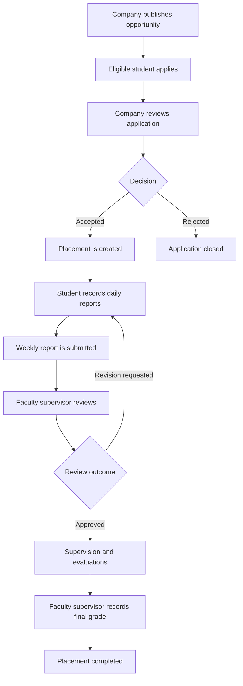

# SIMS — Student Internship Management System

<p align="center">
<<<<<<< HEAD
  <strong>A centralized platform for managing the university-to-workplace internship lifecycle.</strong>
  <br />
  Connect universities, students, and companies through structured applications, placements, supervision, evaluations, and grading.
</p>

<p align="center">
  
  
  
  
  
=======
  
  
  
  
</p>

<p align="center">
  <strong>One connected workspace for university internships.</strong><br />
  SIMS brings students, universities, and employers together to manage internship opportunities, applications, placements, supervision, reporting, and academic evaluation.
</p>

<p align="center">
  <a href="https://github.com/tombawo128/SIMS">Repository</a> ·
  <a href="https://github.com/tombawo128/SIMS/issues">Issues</a> ·
  <a href="https://github.com/tombawo128/SIMS/pulls">Pull requests</a>
>>>>>>> 531fd9bebf7bc36fd1285eab65e77096e28c7670
</p>

---

<<<<<<< HEAD
## Contents

- [Overview](#overview)
- [Core capabilities](#core-capabilities)
- [Technology](#technology)
- [Architecture](#architecture)
- [User roles](#user-roles)
- [Internship lifecycle](#internship-lifecycle)
- [Security](#security)
- [Getting started](#getting-started)
- [Environment configuration](#environment-configuration)
- [Demo data](#demo-data)
- [Database tests and verification](#database-tests-and-verification)
- [Deployment](#deployment)
- [Project structure](#project-structure)
- [Roadmap](#roadmap)

## Overview

SIMS is a multi-tenant Student Internship Management System built to coordinate internship activities between universities and companies.

The platform supports the process from opportunity publication and student applications to placement supervision, weekly activity logs, evaluations, and final academic grading. Universities and companies operate within their own tenant boundaries, with access controlled by PostgreSQL Row Level Security (RLS).

**Current delivery:** React web application backed by Supabase.  
**Planned next phase:** Expo / React Native mobile application reusing the shared domain package.

## Core capabilities

| Area | Capabilities |
| --- | --- |
| Opportunities | Company-managed internship and graduate-role postings, including university-specific visibility |
| Applications | Student applications, withdrawal, review, shortlisting, acceptance, and rejection |
| Placements | Placement creation and lifecycle management after an application is accepted |
| Supervision | Weekly logs, review workflows, check-ins, and supervisor assignments |
| Evaluation | Midterm and final evaluations by the relevant supervisors |
| Academic results | Coordinator-managed grading |
| Administration | Tenant management, account approval, user moderation, and platform administration |
| Notifications | In-app notifications with Supabase Realtime |
| Documents | CV and report storage with access controlled by storage policies |

## Technology

| Layer | Technology |
| --- | --- |
| Frontend | React 18, TypeScript, Vite 6 |
| Routing | React Router 6 |
| Server state | TanStack Query 5 |
| Styling | CSS with a design-token system |
| Backend platform | Supabase |
| Database | PostgreSQL 17 |
| Authentication | Supabase Auth |
| Authorization | PostgreSQL Row Level Security and role-aware database functions |
| Server-side workflows | Supabase Edge Functions and SQL RPCs |
| Shared domain | `@sims/shared` |
| Database testing | pgTAP |

## Architecture

SIMS is organized as a workspace with a web application, a shared domain package, and Supabase backend resources.

```text
SIMS
├── apps/
│   └── web/                 React + TypeScript web application
├── packages/
│   └── shared/              Shared types, roles, constants, and utilities
└── supabase/
    ├── migrations/          Database schema, RPCs, RLS, storage, and realtime
    ├── functions/           Server-side Edge Functions
    ├── tests/               pgTAP database tests
    └── seed.sql             Local development sample data
```

Privileged and multi-step operations are handled by database functions or Edge Functions rather than trusting client-side role or tenant values.

## User roles

SIMS supports six application roles:

| Role | Main responsibilities |
| --- | --- |
| `student` | Browse eligible opportunities, apply, manage placement activity, and submit weekly logs |
| `faculty_supervisor` | Review student logs and complete faculty evaluations |
| `coordinator` | Assign faculty supervisors, oversee university placements, and record grades |
| `site_supervisor` | Supervise workplace placements, review logs, and complete site evaluations |
| `company_admin` | Manage company opportunities, review applicants, hire students, and invite site supervisors |
| `platform_admin` | Manage tenants, oversee users, approve accounts, and administer the platform |

Platform administration is separate from university and company tenant access. The platform supports a maximum of **two** platform-admin accounts, with the limit enforced server-side.

## Internship lifecycle

The main workflow follows this progression:

```text
Opportunity
  draft → published → closed
      │
      ▼
Application
  draft → submitted → under_review → shortlisted
                                      │
                         ┌────────────┴────────────┐
                         ▼                         ▼
                     accepted                  rejected
                         │
                         ▼
Placement
  active → completed / cancelled
      │
      ├── Weekly activity logs → review / revision
      ├── Supervisor check-ins
      ├── Midterm and final evaluations
      ├── CVs and reports
      └── Final grade (recorded by coordinator)
```

Posting visibility can be open to all universities or restricted to selected universities. Students only receive published opportunities available to their university.

## Security

Security is enforced at the database and server boundaries, not only through frontend route visibility.

- **Tenant isolation:** RLS policies scope access to the authenticated user's university or company.
- **Role protection:** Users cannot grant themselves a role or change their tenant assignment.
- **Account approval:** Student registrations begin in a pending state and must be approved by a platform administrator before application access is granted. Pending, suspended, and blocked accounts are denied tenant data access by database authorization helpers.
- **Email confirmation:** SIMS separates email verification from administrator approval. The repository's local Supabase configuration sets `auth.email.enable_confirmations = false`, so local users can sign in without confirming an email address. For the hosted project, configure the equivalent **Authentication → Sign In / Providers → Email → Confirm email** setting to OFF if password sign-in should not require email verification. This does not approve an account or bypass the SIMS administrator-approval checks.
- **Trusted provisioning:** Privileged account creation is performed by server-side functions using trusted application metadata.
- **Admin authorization:** User directory, moderation, tenant deletion, and platform-admin management are restricted to authorized platform administrators.
- **Private documents:** CVs and reports use private storage buckets and policy-controlled access. Company logos use a public bucket.
- **Audit and notifications:** Sensitive changes are recorded, and relevant user notifications are generated by backend workflows.
- **Secret handling:** The Supabase service-role key must remain server-side and must never be exposed through a `VITE_*` variable.

### Edge Functions

The repository includes these functions:

| Function | Purpose |
| --- | --- |
| `invite-user` | Validates and provisions invited staff accounts |
| `manage-admins` | Creates and removes platform-admin accounts within the two-admin limit |
| `signup-admin` | Handles the public, capped initial administrator signup flow |
| `manage-users` | Handles privileged user and tenant deletion workflows |

## Getting started

### Prerequisites

- Node.js 18 or later (Node.js 20 or 22 recommended)
- npm
- Docker Desktop, for running the local Supabase stack
- Supabase CLI, invoked through `npx`

### 1. Install dependencies

```bash
npm install
```

### 2. Start local Supabase
=======
## At a glance

| | |
|---|---|
| **Product** | Student Internship Management System |
| **Application** | React web application |
| **Architecture** | Multi-tenant, role-based platform |
| **Frontend** | React 18 · TypeScript · Vite |
| **Backend** | Supabase · PostgreSQL · Auth · Edge Functions |
| **Data security** | PostgreSQL Row Level Security (RLS) |
| **Database tests** | pgTAP |
| **Development status** | Active development; release checks are ongoing |

> **Release note:** This repository is under active development. A successful frontend build does not, by itself, mean that production deployment is approved. Review the current pull-request checks and the production migration reconciliation notes before deploying backend changes.

## The problem SIMS addresses

Internship administration often involves separate processes for job opportunities, student applications, placement assignment, workplace supervision, weekly reports, evaluations, and final grades.

SIMS brings those workflows into one system. Each organisation works within its own data boundary, while the platform supports the complete journey from opportunity publication to placement completion.

## Platform capabilities

<table>
  <tr>
    <td width="50%">
      <h3>🎓 Student workspace</h3>
      <ul>
        <li>Discover eligible internship opportunities</li>
        <li>Submit and track applications</li>
        <li>View placement details and supervisors</li>
        <li>Record daily activity and learning outcomes</li>
        <li>Submit weekly reports for review</li>
        <li>Manage profile and CV documents</li>
      </ul>
    </td>
    <td width="50%">
      <h3>🏫 University workspace</h3>
      <ul>
        <li>Coordinate students and faculty supervisors</li>
        <li>Assign supervisors to placements</li>
        <li>Review weekly reports and request revisions</li>
        <li>Conduct faculty evaluations</li>
        <li>Record official final internship grades</li>
        <li>Monitor placement and academic analytics</li>
      </ul>
    </td>
  </tr>
  <tr>
    <td width="50%">
      <h3>🏢 Company workspace</h3>
      <ul>
        <li>Create and publish internship opportunities</li>
        <li>Restrict postings to selected universities</li>
        <li>Review, shortlist, accept, or reject applicants</li>
        <li>Manage workplace supervisors</li>
        <li>Review placement activity and evaluations</li>
        <li>View company-level analytics</li>
      </ul>
    </td>
    <td width="50%">
      <h3>🛡️ Platform administration</h3>
      <ul>
        <li>Manage university and company tenants</li>
        <li>Approve and moderate accounts</li>
        <li>Manage platform administrators</li>
        <li>Review system-wide activity</li>
        <li>Manage external integrations and API credentials</li>
        <li>Use audit-aware administrative workflows</li>
      </ul>
    </td>
  </tr>
</table>

## Roles and access

SIMS uses role-aware access controls for six application roles.

| Role | Primary responsibility |
|---|---|
| `student` | Opportunities, applications, placement activity, and reports |
| `faculty_supervisor` | Assigned student supervision, report review, evaluation, and official grading |
| `coordinator` | University placement coordination, faculty assignment, and analytics |
| `site_supervisor` | Workplace supervision, check-ins, and site evaluation |
| `company_admin` | Company opportunities, applicant decisions, and supervisor management |
| `platform_admin` | Tenant administration, account moderation, and platform oversight |

Access is enforced at the database and server layers. Hiding a page or button in the frontend is not treated as an authorization boundary.

## How the internship workflow works



**Academic ownership:** The assigned university faculty supervisor records the official final internship grade. Company administrators can view that grade but cannot change it.

## Analytics and reporting

The analytics workspace provides tenant-scoped views, including:

- Placement and application pipeline summaries
- Active and completed placement counts
- Daily and weekly reporting activity
- Weekly reports awaiting review or returned for revision
- Faculty supervisor workload
- Department and programme breakdowns
- Midterm and final evaluation summaries
- Official grade summaries for authorised university users
- Date-filtered registers and CSV exports

Analytics should reflect authorised database records. Empty states are preferable to fabricated totals or placeholder metrics.

## Integration Centre

SIMS includes an administrator-managed integration area for connecting an external system to one existing university or company tenant.

The current integration API is designed as a read-only v1. Its supported resources include:

| Resource | Scope |
|---|---|
| Organisation details | `organisation:read` |
| Opportunities | `opportunities:read` |
| Applications | `applications:read` |
| Placements | `placements:read` |

Integration credentials are generated server-side, shown once, and stored as hashes. The API derives tenant scope from the validated connection rather than accepting a tenant ID from the caller. Write endpoints and webhooks are not part of this release. Platform administrators can review connection and API-credential administration events in the Integration Centre audit view. Per-request API telemetry, webhook delivery, SSO provider configuration, and public embed hosting remain outside the current read-only API release.

## Technology

| Area | Tools |
|---|---|
| Frontend | React 18, TypeScript, Vite 6 |
| Routing | React Router |
| Server state | TanStack Query |
| Styling | CSS and shared design tokens |
| Backend platform | Supabase |
| Database | PostgreSQL |
| Authentication | Supabase Auth |
| Authorization | PostgreSQL RLS and role-aware SQL functions |
| Server-side workflows | Supabase Edge Functions and RPCs |
| Shared code | `@sims/shared` |
| Database verification | pgTAP and Supabase CLI |
| CI | GitHub Actions |

## Architecture

The repository is organised as an npm workspace.

```text
SIMS/
├── apps/
│   └── web/                 # React + TypeScript application
├── packages/
│   └── shared/              # Shared types, roles, constants and utilities
├── supabase/
│   ├── migrations/          # Schema, RLS, functions, storage and realtime
│   ├── functions/           # Edge Functions
│   ├── tests/               # pgTAP database tests
│   └── seed.sql             # Local development seed data
├── docs/                    # Operational and migration documentation
├── scripts/                 # Verification utilities
├── .github/workflows/       # CI workflows
├── .env.example
└── package.json
```

## Run locally

### Prerequisites

- Node.js 20 or 22 recommended
- npm
- Docker Desktop or another supported Docker installation
- Supabase CLI (the project scripts use `npx supabase`)

### 1. Clone and install

```bash
git clone https://github.com/tombawo128/SIMS.git
cd SIMS
npm install
```

### 2. Start the local Supabase stack
>>>>>>> 531fd9bebf7bc36fd1285eab65e77096e28c7670

```bash
npx supabase start
```

<<<<<<< HEAD
The first run downloads the required Docker images. The CLI prints the local API URL and anon key when the services start.

### 3. Apply migrations and seed data

```bash
npx supabase db reset
```

This recreates the local database, applies migrations, and loads the configured seed data.

### 4. Configure the web application

Copy the example environment file:

```bash
cp .env.example .env
```

Add the local Supabase URL and anon key as described below.

### 5. Start the development server

```bash
npm run dev
```

Open [http://localhost:5173](http://localhost:5173).

### Local Supabase services

| Service | Local address |
| --- | --- |
| API | `http://127.0.0.1:54321` |
| Supabase Studio | `http://127.0.0.1:54323` |
| Database | `127.0.0.1:54322` |
| Inbucket email testing | `http://127.0.0.1:54324` |

## Environment configuration

The web app reads the root `.env` file.

```dotenv
VITE_SUPABASE_URL=http://127.0.0.1:54321
VITE_SUPABASE_ANON_KEY=<your-local-anon-key>
```

Only the Supabase project URL and public anon key belong in the browser environment.

> **Important:** Never place `SUPABASE_SERVICE_ROLE_KEY` in a frontend environment variable or expose it to the browser. Keep it in the server-side environment used by Supabase Edge Functions.

For local function development, Supabase CLI injects `SUPABASE_URL`, `SUPABASE_ANON_KEY`, and `SUPABASE_SERVICE_ROLE_KEY` when serving functions through the local stack.

## Demo data

The local seed file provides sample universities, companies, users, opportunities, applications, and placements for development.

Seeded accounts use the development password `Password123!`. These credentials are for the local development environment only; do not use them in production.

| Role | Example account |
| --- | --- |
| Platform administrator | `admin@sims.dev` |
| University coordinator | `coordinator@baystate.edu` |
| Faculty supervisor | `faculty1@baystate.edu` |
| Student | `student1@baystate.edu` |
| Company administrator | `admin@acme.com` |
| Site supervisor | `supervisor1@acme.com` |

Public student registrations start as **pending** and require administrator approval before accessing the application. Email confirmation is a separate Supabase Auth setting: local development has it disabled in `supabase/config.toml`. The hosted Supabase project must be configured separately; disabling email confirmation must never be treated as a substitute for SIMS account approval.

## Database tests and verification

Run the database test suite against the local Supabase database:

```bash
npx supabase db reset
npx supabase test db
```

The pgTAP suite is located at `supabase/tests/rls.test.sql` and contains 25 assertions covering tenant isolation, posting visibility, company scoping, workflow permissions, and privilege-escalation protections.

Run frontend checks with:
=======
The first startup downloads the required containers. The CLI prints the local API URL and public anon key.

### 3. Create your local environment file

Copy `.env.example` to `.env` and use the local URL and anon key printed by the Supabase CLI.

```dotenv
VITE_SUPABASE_URL=http://127.0.0.1:54321
VITE_SUPABASE_ANON_KEY=your-local-anon-key
```

### 4. Rebuild the local database

```bash
npx supabase db reset
```

This resets the local database, applies the repository migrations, and loads configured local seed data.

### 5. Start the web application

```bash
npm run dev
```

Open [http://localhost:5173](http://localhost:5173).

## Useful commands
>>>>>>> 531fd9bebf7bc36fd1285eab65e77096e28c7670

| Command | Purpose |
|---|---|
| `npm run dev` | Start the web development server |
| `npm run typecheck` | Run the web TypeScript checks |
| `npm run build` | Build the web application |
| `npm run preview` | Preview the built web application |
| `npx supabase start` | Start local Supabase |
| `npx supabase stop` | Stop local Supabase |
| `npx supabase db reset` | Rebuild the local database from migrations |
| `npx supabase test db` | Run pgTAP database tests |
| `npm run smoke:production` | Check production HTML and referenced assets |

## Security principles

- **Tenant isolation:** RLS policies scope records to the authenticated user's university or company.
- **Server-side authorization:** Privileged operations validate the caller's role, account state, and tenant relationship.
- **Account lifecycle:** Pending, suspended, and archived accounts must not retain privileged access.
- **Private files:** CVs and reports use private storage and policy-controlled access.
- **Secret handling:** The Supabase service-role key must never be exposed in browser code or a `VITE_*` variable.
- **Integration isolation:** External API keys are scoped to one tenant and the permissions granted to that connection.
- **Auditability:** Sensitive administrative and integration actions should be traceable.

### Production deployment caution

Production database migration history must be reconciled with the repository before applying migrations. Do not run `supabase db push` against production simply because local migrations pass. Review the production migration reconciliation document, take a verified backup, and use a reviewed rollout plan.

Vercel Preview should use a separate staging Supabase project. Do not run destructive or write-based test flows against a preview environment that points to production data.

## Verification and release readiness

The project uses GitHub Actions to check the frontend, type-check Edge Functions, rebuild a local Supabase database, run SQL tests, and smoke-check the deployed web assets.

A green frontend build does not prove that production database policies, live Edge Functions, storage permissions, or user workflows are correct. Check the latest workflow results and complete the production safety review before release.

- [GitHub Actions](https://github.com/tombawo128/SIMS/actions)
- [Open pull requests](https://github.com/tombawo128/SIMS/pulls)
- [Production migration reconciliation](docs/production-migration-reconciliation.md)

## Roadmap

- [x] Multi-role internship management foundation
- [x] Student applications and placement workflows
- [x] Daily reporting and weekly faculty review workflow
- [x] Supervisor check-ins and evaluations
- [x] University and company analytics
- [x] Read-only integration API foundation
- [ ] Complete the current database security regression suite
- [ ] Reconcile and safely apply outstanding production migrations
- [ ] Isolate Preview from production Supabase data
- [ ] Complete live end-to-end verification of privileged workflows
- [ ] Develop the planned mobile application

## Contributing

1. Create a focused branch for your change.
2. Keep authorization checks in the database or trusted server-side functions.
3. Add or update pgTAP coverage when changing database permissions or workflows.
4. Run the relevant type checks, build, and database tests.
5. Open a pull request with a clear summary and verification notes.

## License

No license file is currently specified in this repository. All rights are reserved unless a license is added.

### Verification notes

<<<<<<< HEAD
The repository's recorded verification status reports successful dependency installation, TypeScript checks, and production build. Several UI flows have also been exercised against a mocked Supabase backend.

The local Supabase database reset and pgTAP suite were **not run in the recorded environment because Docker was unavailable**. Mocked frontend checks do not prove live database RLS behavior. Run the database tests in a Docker-capable environment or against an appropriately configured test project before treating database security as fully verified.

## Deployment

1. Create a Supabase project and link the repository:
   ```bash
   npx supabase link --project-ref <project-ref>
   ```
2. Apply database migrations:
   ```bash
   npx supabase db push
   ```
   Do not deploy `supabase/seed.sql` to production.
3. Set the required server-side function secrets. Keep the service-role key out of the frontend.
4. Deploy all four Edge Functions:
   ```bash
   npx supabase functions deploy invite-user
   npx supabase functions deploy manage-admins
   npx supabase functions deploy signup-admin
   npx supabase functions deploy manage-users
   ```
5. In Supabase Auth settings, configure the production Site URL and the allowed redirect URLs, including the password-reset route. Under **Authentication → Sign In / Providers → Email**, turn **Confirm email** OFF if the intended SIMS login flow does not require email verification. This hosted dashboard setting is separate from the local `auth.email.enable_confirmations = false` setting in `supabase/config.toml`. Keep SIMS administrator approval and database authorization checks enabled.
6. Configure the web host with `VITE_SUPABASE_URL` and `VITE_SUPABASE_ANON_KEY`.
7. Build and deploy the static web output from `apps/web/dist`. Configure the host to serve `index.html` as the SPA fallback.

Storage buckets, RLS policies, and realtime publication are created by the database migrations.

## Project structure

```text
apps/web/                 Frontend application
packages/shared/          Shared domain package
supabase/migrations/      Database migrations
supabase/functions/       Edge Functions
supabase/tests/           pgTAP tests
supabase/seed.sql         Local sample data
```

## Roadmap

- [x] React web application foundation
- [x] Multi-role and multi-tenant application model
- [x] Supabase authentication and database authorization model
- [x] Internship application and placement workflows
- [x] Supervisor logs and evaluation workflows
- [x] Platform-admin and account-moderation workflows
- [ ] Execute the full pgTAP suite against a running database
- [ ] Complete live end-to-end verification of privileged Edge Functions
- [ ] Build the Expo / React Native mobile application using `@sims/shared`

---

<p align="center">
  <strong>SIMS — bringing internship coordination into one structured platform.</strong>
=======
<p align="center">
  <strong>SIMS</strong><br />
  <sub>Connecting academic learning with real workplace experience.</sub>
>>>>>>> 531fd9bebf7bc36fd1285eab65e77096e28c7670
</p>
