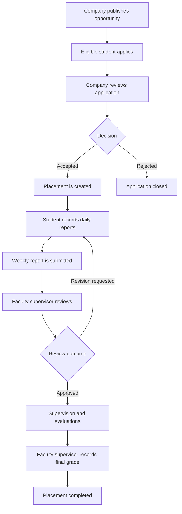

# SIMS — Student Internship Management System

<p align="center">
  
  
  
  
</p>

<p align="center">
  <strong>One connected workspace for university internships.</strong><br />
  SIMS brings students, universities, and employers together to manage internship opportunities, applications, placements, supervision, reporting, and academic evaluation.
</p>

<p align="center">
  <a href="https://github.com/tombawo128/SIMS">Repository</a> ·
  <a href="https://github.com/tombawo128/SIMS/issues">Issues</a> ·
  <a href="https://github.com/tombawo128/SIMS/pulls">Pull requests</a>
</p>

---

## At a glance

| | |
|---|---|
| **Product** | Student Internship Management System |
| **Application** | React web application |
| **Architecture** | Multi-tenant, role-based platform |
| **Frontend** | React 18 · TypeScript · Vite |
| **Backend** | Supabase · PostgreSQL · Auth · Edge Functions |
| **Data security** | PostgreSQL Row Level Security (RLS) |
| **Database tests** | pgTAP |
| **Development status** | Active development; release checks are ongoing |

> **Release note:** This repository is under active development. A successful frontend build does not, by itself, mean that production deployment is approved. Review the current pull-request checks and the production migration reconciliation notes before deploying backend changes.

## The problem SIMS addresses

Internship administration often involves separate processes for job opportunities, student applications, placement assignment, workplace supervision, weekly reports, evaluations, and final grades.

SIMS brings those workflows into one system. Each organisation works within its own data boundary, while the platform supports the complete journey from opportunity publication to placement completion.

## Platform capabilities

<table>
  <tr>
    <td width="50%">
      <h3>🎓 Student workspace</h3>
      <ul>
        <li>Discover eligible internship opportunities</li>
        <li>Submit and track applications</li>
        <li>View placement details and supervisors</li>
        <li>Record daily activity and learning outcomes</li>
        <li>Submit weekly reports for review</li>
        <li>Manage profile and CV documents</li>
      </ul>
    </td>
    <td width="50%">
      <h3>🏫 University workspace</h3>
      <ul>
        <li>Coordinate students and faculty supervisors</li>
        <li>Assign supervisors to placements</li>
        <li>Review weekly reports and request revisions</li>
        <li>Conduct faculty evaluations</li>
        <li>Record official final internship grades</li>
        <li>Monitor placement and academic analytics</li>
      </ul>
    </td>
  </tr>
  <tr>
    <td width="50%">
      <h3>🏢 Company workspace</h3>
      <ul>
        <li>Create and publish internship opportunities</li>
        <li>Restrict postings to selected universities</li>
        <li>Review, shortlist, accept, or reject applicants</li>
        <li>Manage workplace supervisors</li>
        <li>Review placement activity and evaluations</li>
        <li>View company-level analytics</li>
      </ul>
    </td>
    <td width="50%">
      <h3>🛡️ Platform administration</h3>
      <ul>
        <li>Manage university and company tenants</li>
        <li>Approve and moderate accounts</li>
        <li>Manage platform administrators</li>
        <li>Review system-wide activity</li>
        <li>Manage external integrations and API credentials</li>
        <li>Use audit-aware administrative workflows</li>
      </ul>
    </td>
  </tr>
</table>

## Roles and access

SIMS uses role-aware access controls for six application roles.

| Role | Primary responsibility |
|---|---|
| `student` | Opportunities, applications, placement activity, and reports |
| `faculty_supervisor` | Assigned student supervision, report review, evaluation, and official grading |
| `coordinator` | University placement coordination, faculty assignment, and analytics |
| `site_supervisor` | Workplace supervision, check-ins, and site evaluation |
| `company_admin` | Company opportunities, applicant decisions, and supervisor management |
| `platform_admin` | Tenant administration, account moderation, and platform oversight |

Access is enforced at the database and server layers. Hiding a page or button in the frontend is not treated as an authorization boundary.

## How the internship workflow works



**Academic ownership:** The assigned university faculty supervisor records the official final internship grade. Company administrators can view that grade but cannot change it.

## Analytics and reporting

The analytics workspace provides tenant-scoped views, including:

- Placement and application pipeline summaries
- Active and completed placement counts
- Daily and weekly reporting activity
- Weekly reports awaiting review or returned for revision
- Faculty supervisor workload
- Department and programme breakdowns
- Midterm and final evaluation summaries
- Official grade summaries for authorised university users
- Date-filtered registers and CSV exports

Analytics should reflect authorised database records. Empty states are preferable to fabricated totals or placeholder metrics.

## Integration Centre

SIMS includes an administrator-managed integration area for connecting an external system to one existing university or company tenant.

The current integration API is designed as a read-only v1. Its supported resources include:

| Resource | Scope |
|---|---|
| Organisation details | `organisation:read` |
| Opportunities | `opportunities:read` |
| Applications | `applications:read` |
| Placements | `placements:read` |

Integration credentials are generated server-side, shown once, and stored as hashes. The API derives tenant scope from the validated connection rather than accepting a tenant ID from the caller. Write endpoints and webhooks are not part of this release. Platform administrators can review connection and API-credential administration events in the Integration Centre audit view. Per-request API telemetry, webhook delivery, SSO provider configuration, and public embed hosting remain outside the current read-only API release.

## Technology

| Area | Tools |
|---|---|
| Frontend | React 18, TypeScript, Vite 6 |
| Routing | React Router |
| Server state | TanStack Query |
| Styling | CSS and shared design tokens |
| Backend platform | Supabase |
| Database | PostgreSQL |
| Authentication | Supabase Auth |
| Authorization | PostgreSQL RLS and role-aware SQL functions |
| Server-side workflows | Supabase Edge Functions and RPCs |
| Shared code | `@sims/shared` |
| Database verification | pgTAP and Supabase CLI |
| CI | GitHub Actions |

## Architecture

The repository is organised as an npm workspace.

```text
SIMS/
├── apps/
│   └── web/                 # React + TypeScript application
├── packages/
│   └── shared/              # Shared types, roles, constants and utilities
├── supabase/
│   ├── migrations/          # Schema, RLS, functions, storage and realtime
│   ├── functions/           # Edge Functions
│   ├── tests/               # pgTAP database tests
│   └── seed.sql             # Local development seed data
├── docs/                    # Operational and migration documentation
├── scripts/                 # Verification utilities
├── .github/workflows/       # CI workflows
├── .env.example
└── package.json
```

## Run locally

### Prerequisites

- Node.js 20 or 22 recommended
- npm
- Docker Desktop or another supported Docker installation
- Supabase CLI (the project scripts use `npx supabase`)

### 1. Clone and install

```bash
git clone https://github.com/tombawo128/SIMS.git
cd SIMS
npm install
```

### 2. Start the local Supabase stack

```bash
npx supabase start
```

The first startup downloads the required containers. The CLI prints the local API URL and public anon key.

### 3. Create your local environment file

Copy `.env.example` to `.env` and use the local URL and anon key printed by the Supabase CLI.

```dotenv
VITE_SUPABASE_URL=http://127.0.0.1:54321
VITE_SUPABASE_ANON_KEY=your-local-anon-key
```

### 4. Rebuild the local database

```bash
npx supabase db reset
```

This resets the local database, applies the repository migrations, and loads configured local seed data.

### 5. Start the web application

```bash
npm run dev
```

Open [http://localhost:5173](http://localhost:5173).

## Useful commands

| Command | Purpose |
|---|---|
| `npm run dev` | Start the web development server |
| `npm run typecheck` | Run the web TypeScript checks |
| `npm run build` | Build the web application |
| `npm run preview` | Preview the built web application |
| `npx supabase start` | Start local Supabase |
| `npx supabase stop` | Stop local Supabase |
| `npx supabase db reset` | Rebuild the local database from migrations |
| `npx supabase test db` | Run pgTAP database tests |
| `npm run smoke:production` | Check production HTML and referenced assets |

## Security principles

- **Tenant isolation:** RLS policies scope records to the authenticated user's university or company.
- **Server-side authorization:** Privileged operations validate the caller's role, account state, and tenant relationship.
- **Account lifecycle:** Pending, suspended, and archived accounts must not retain privileged access.
- **Private files:** CVs and reports use private storage and policy-controlled access.
- **Secret handling:** The Supabase service-role key must never be exposed in browser code or a `VITE_*` variable.
- **Integration isolation:** External API keys are scoped to one tenant and the permissions granted to that connection.
- **Auditability:** Sensitive administrative and integration actions should be traceable.

### Production deployment caution

Production database migration history must be reconciled with the repository before applying migrations. Do not run `supabase db push` against production simply because local migrations pass. Review the production migration reconciliation document, take a verified backup, and use a reviewed rollout plan.

Vercel Preview should use a separate staging Supabase project. Do not run destructive or write-based test flows against a preview environment that points to production data.

## Verification and release readiness

The project uses GitHub Actions to check the frontend, type-check Edge Functions, rebuild a local Supabase database, run SQL tests, and smoke-check the deployed web assets.

A green frontend build does not prove that production database policies, live Edge Functions, storage permissions, or user workflows are correct. Check the latest workflow results and complete the production safety review before release.

- [GitHub Actions](https://github.com/tombawo128/SIMS/actions)
- [Open pull requests](https://github.com/tombawo128/SIMS/pulls)
- [Production migration reconciliation](docs/production-migration-reconciliation.md)

## Roadmap

- [x] Multi-role internship management foundation
- [x] Student applications and placement workflows
- [x] Daily reporting and weekly faculty review workflow
- [x] Supervisor check-ins and evaluations
- [x] University and company analytics
- [x] Read-only integration API foundation
- [ ] Complete the current database security regression suite
- [ ] Reconcile and safely apply outstanding production migrations
- [ ] Isolate Preview from production Supabase data
- [ ] Complete live end-to-end verification of privileged workflows
- [ ] Develop the planned mobile application

## Contributing

1. Create a focused branch for your change.
2. Keep authorization checks in the database or trusted server-side functions.
3. Add or update pgTAP coverage when changing database permissions or workflows.
4. Run the relevant type checks, build, and database tests.
5. Open a pull request with a clear summary and verification notes.

## License

No license file is currently specified in this repository. All rights are reserved unless a license is added.

---

<p align="center">
  <strong>SIMS</strong><br />
  <sub>Connecting academic learning with real workplace experience.</sub>
</p>
